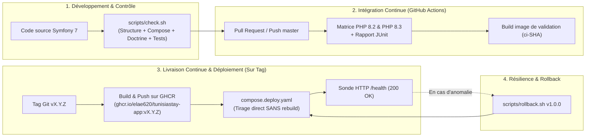
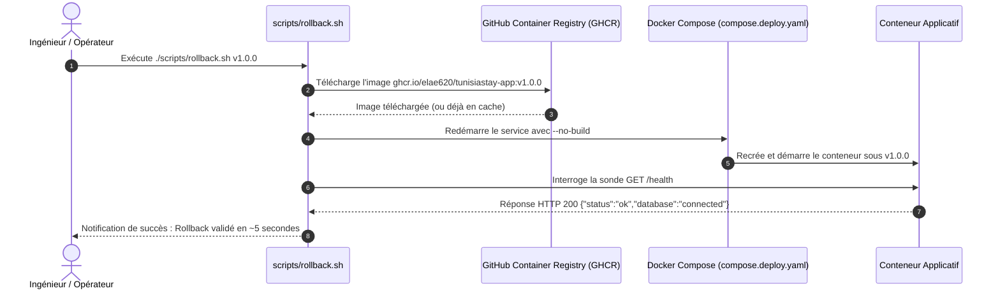

# Fiche de Synthèse DevOps — Projet TunisiaStay

**Étudiant :** Licence 3 · DSI · ISET  
**Dépôt GitHub :** [https://github.com/elae620/TunisiaStay](https://github.com/elae620/TunisiaStay)  
**Version mise en service :** `v1.0.0` (Image GHCR : `ghcr.io/elae620/tunisiastay-app:v1.0.0`)

---

## 1. Architecture globale de l'application et de la chaîne DevOps



### Composants clés
- **Application Web** : Symfony 7.4, PHP 8.2 Apache (utilisateur non-root `www-data`, port 8080).
- **Base de données** : MariaDB 10.11 (volume persistant `database_data`, réseau interne isolé sans port exposé).
- **Sonde de santé** : Route dédiée `/health` vérifiant la connectivité Doctrine et le statut applicatif.
- **Principe d'immutabilité** : Les images déployées proviennent strictement du registre GitHub Packages (GHCR) et ne sont **jamais reconstruites** lors de la mise en service.

---

## 2. Déroulé du Retour Arrière (Rollback)

La procédure de retour arrière permet de rétablir instantanément une version antérieure stable sans aucune recompilation de code.



### Commande exécutée pour la démonstration :
```bash
# L'application tourne en version v1.0.1
# Commande de retour arrière vers la version stable :
bash scripts/rollback.sh v1.0.0
```

### Résultat constaté :
1. L'image `ghcr.io/elae620/tunisiastay-app:v1.0.0` est récupérée depuis GHCR.
2. Le conteneur en service est recréé et redémarré en **moins de 5 secondes**.
3. La sonde `http://localhost:8080/health` valide la disponibilité immédiate avec un code HTTP 200.

---

## 3. Récapitulatif des livrables et adresses d'exécution

- **Démarrage du projet en une commande** : `docker compose up -d` (documenté dans `README.md`).
- **Pipeline en Échec (Rouge)** : Pull Request démontrant le blocage de la fusion et de la conteneurisation en cas de régression unitaire.
- **Pipeline Réussi (Vert)** : Exécution validant les tests sur PHP 8.2 et PHP 8.3 avec génération d'artefacts JUnit et construction de l'image.
- **Mise en service sur Tag** : Déclenchée automatiquement par `v1.0.0` avec publication sur GHCR et déploiement vérifié.
